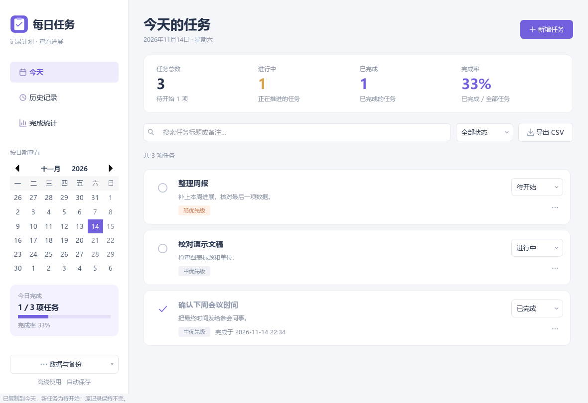
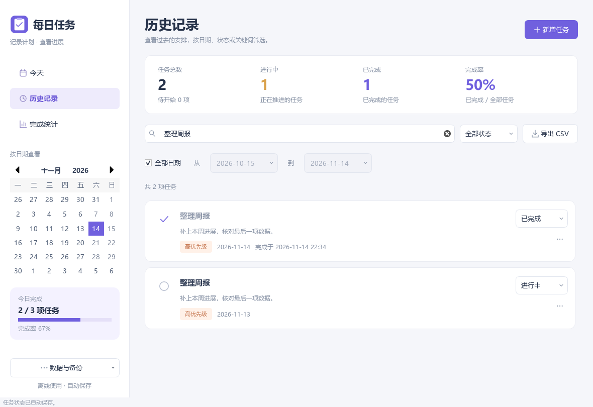

# Daily Tasks · Offline to-do list for Windows

[简体中文](README.md) · English

Pick up yesterday’s unfinished work without losing its history. Daily Tasks lets you copy a task to today with its notes and priority, mark the new entry complete, and look back at what actually happened on each date.

**[Download the portable Windows x64 EXE](https://github.com/troulierkilian-blip/daily-tasks/releases/latest/download/DailyTasks-Windows-x64.exe)** · [Release notes and SHA-256 checksum](https://github.com/troulierkilian-blip/daily-tasks/releases/latest)

Runs offline on Windows 10 / 11 x64. No account or Python installation is required. The interface is in Simplified Chinese; the steps below include the labels you’ll see.



## Carry a task over to today

1. Select **新增任务** (New task) or press `Ctrl+N`. Enter a title, date, priority and notes. Use **进行中** (In progress) when you start working.
2. The next day, select yesterday in the calendar. Open the task’s **…** menu and choose **复制到今天** (Copy to today). Select **今天** (Today) to see the new pending entry. Click its circle when you finish.
3. Open **历史记录** (History) and search the title or notes. In the example, yesterday’s weekly report still reads **进行中** (In progress) and today’s copy reads **已完成** (Done). Choose **导出 CSV** (Export CSV) to open just those results in Excel.



## Review progress and back up

**完成统计** (Completion statistics) shows completed tasks as a share of all tasks for today, the last seven days or the current month. Records are saved locally, typically in `%LOCALAPPDATA%\DailyTasks\tasks.db`. To move your records, use **数据与备份** (Data & backup) to back up the database and restore it on the other PC. See the [Chinese user guide](使用说明.md) for filters, keyboard shortcuts and backup details.

## Run from source

Install 64-bit Python 3.10 on Windows, then run these commands in PowerShell from the repository root.

```powershell
py -3.10 -m venv .venv
.\.venv\Scripts\python.exe -m pip install -r requirements-lock.txt
.\.venv\Scripts\python.exe main.py
```

To run the tests and package the executable, run `powershell -ExecutionPolicy Bypass -File .\重新打包.ps1`. The output is `dist\每日任务.exe`. See the [third-party license notices](licenses/) and the [project support section](README.md#支持项目).
